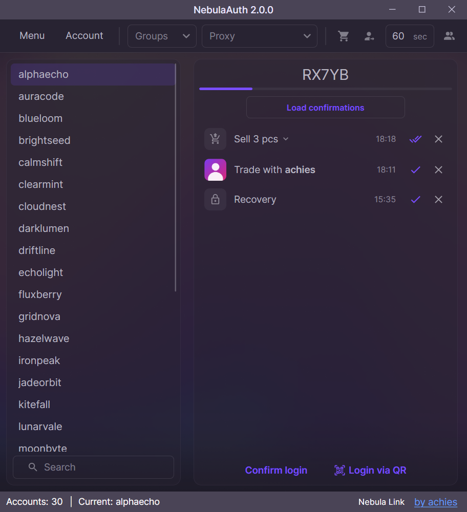

# NebulaAuth

<h3 align="center" style="margin-bottom:0">
  <a href="https://github.com/achiez/NebulaAuth-Steam-Desktop-Authenticator-by-Achies/releases/latest">Download the latest version</a>
</h3>

<h3 align="center">
A desktop Steam authenticator for Windows, macOS and Linux: Steam Guard codes, trade and market confirmations and
logins for all your accounts in one window.
</h3>

NebulaAuth is an independent project and is not affiliated with Valve or Steam.

<h4 align="center"><a href="https://t.me/nebulaauth">Official Telegram group</a></h4>
<h4 align="center"><a href="https://docs.achiefy.pro/en/nebula-auth/">Documentation</a></h4>

  

## Features

- **Windows, macOS and Linux** — one app, the same data and features on every system.
- **Everything the Steam Mobile App does with an authenticator**: Steam Guard codes, trade and market confirmations,
  login confirmation without a code, login by QR code.
- **Encrypted mafiles** — protect your mafiles and saved passwords with a master password.
- **Built-in Steam browser** — open Steam with the selected account in one click, through its proxy.
- **Proxies** for every account, in every request.
- **Automatic confirmations** of trades and market actions.
- **Groups** to keep many accounts in order.
- **Import** of mafiles by drag and drop or Ctrl+V, including SDA-encrypted mafiles.
- **Nebula Link** — optional integration with [Achiefy](https://achiefy.pro/?utm_source=github&utm_medium=readme&utm_campaign=nebulaauth): Achiefy gets codes and confirmations
  from your computer, the mafiles never leave it.
- **Signed updates** — NebulaAuth updates itself and installs only updates signed by the project.
- **8 languages**: English, Russian, Ukrainian, Chinese, French, Spanish, Turkish and Kazakh.

## Installation

Download the file for your system from the [latest release](https://github.com/achiez/NebulaAuth-Steam-Desktop-Authenticator-by-Achies/releases/latest).
Download NebulaAuth only from this repository.

| System | File |
|---|---|
| Windows x64 | `NebulaAuth-win-x64-Portable.zip` |
| macOS, Apple Silicon (M1 and newer) | `NebulaAuth-osx-arm64-Portable.zip` |
| macOS, Intel | `NebulaAuth-osx-x64-Portable.zip` |
| Linux x64 | `NebulaAuth-linux-x64.AppImage` |

### Windows

1. Unpack the archive into any folder you can write to, for example `C:\Users\<you>\NebulaAuth`
   (not `C:\Program Files`).
2. Run `NebulaAuth.exe`.

Your data (`maFiles`, settings, proxies) is stored in the same folder, next to `NebulaAuth.exe`.

### macOS

1. Unpack the archive and move `NebulaAuth.app` to **Applications** (or any folder other than Downloads).
2. Open NebulaAuth. macOS cannot verify the developer and blocks the first launch: click **Done**, open
   **System Settings → Privacy & Security** and click **Open Anyway** next to NebulaAuth.

Your data is stored in `~/Library/Application Support/NebulaAuth`. To keep it next to the app instead (for example on
a USB drive), create a folder named `NebulaAuth Data` next to `NebulaAuth.app`.

### Linux

1. Make the file executable: `chmod +x NebulaAuth-linux-x64.AppImage`.
2. Run it.

Your data is stored in `~/.local/share/NebulaAuth` (or `$XDG_DATA_HOME/NebulaAuth`). A folder named
`NebulaAuth Data` next to the AppImage is used instead when it exists.

## Updates

NebulaAuth checks for updates at startup and installs them only when you click **Update**. Your data is not touched
by an update.

<b>For maintainers: releasing a new version</b>

1. In `dev`, set the version in `src/NebulaAuth/NebulaAuth.csproj`: `<AssemblyVersion>X.Y.Z</AssemblyVersion>`
   (for a beta `X.Y.Z-beta.N` it stays `X.Y.Z`).
2. Add `changelog/<version>.json`: `version` equal to the release version, `date`, and `changes`
   (`type`: `NEW`, `IMPROVEMENT`, `FIX`, `SECURITY` or `INFO`; `text`; optional `link`).
3. Merge into `master` (`dev` → PR → `master`).
4. Push the tag `v<version>` on `master` (for example `v2.0.1`). The **Release** workflow starts by itself
   (or run it from GitHub → Actions → **Release** → **Run workflow** with the version).
5. When the workflow is green, the release is published and the update feeds and `update.xml` are already committed
   to `master` by the workflow — do not edit them by hand.

If the workflow fails, nothing is published: fix it, delete the tag (`git push origin :refs/tags/v<version>`), push
the tag again. A published version is never replaced — release the next one instead.

Secrets: `FEED_SIGNING_KEY` (private key that signs the update feeds; keep an offline backup, a lost key cannot be
replaced for installed apps) and `PAT_TOKEN` (may push to `master`).

## Documentation

The [documentation](https://docs.achiefy.pro/en/nebula-auth/) covers the features and common problems.

## Project ownership

NebulaAuth is the original project by Achiefy™.

Please keep attribution and do not present modified versions as official.

AGPL-3.0 — see [LICENSE](/LICENSE).
